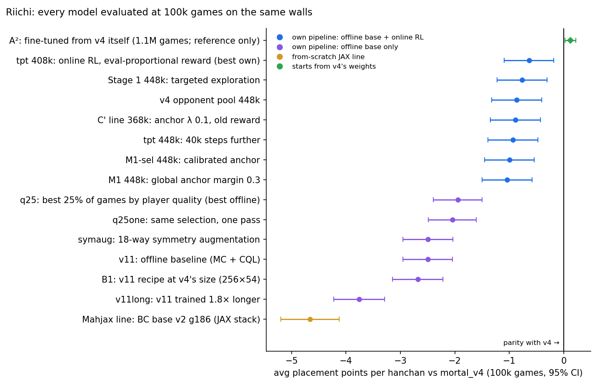
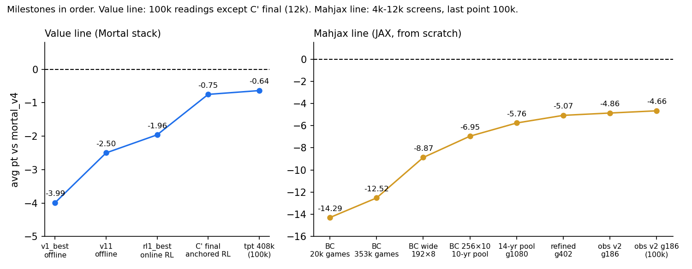
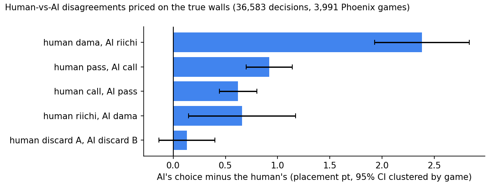
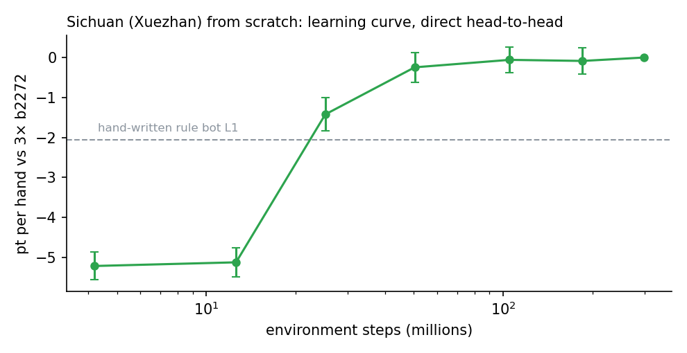
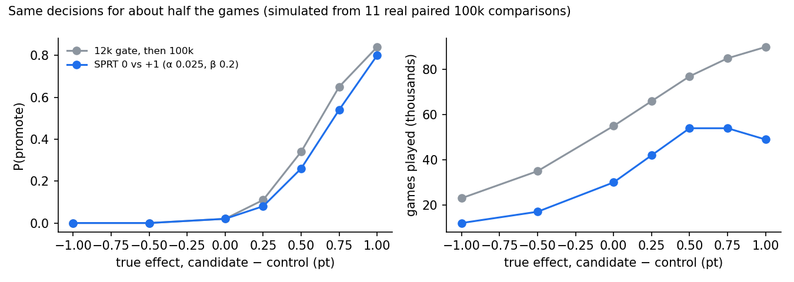

# TanyaoDojo

TanyaoDojo is a research workbench for training mahjong AIs with our own pipelines and measuring them strictly. The
main goal is in **Japanese riichi mahjong**: to beat **Mortal v4** (256ch × 54 blocks, 23.8M parameters, one of the
strongest open-source riichi AIs) with a model trained end to end by this project. That means an offline base learned
from human game logs, then our own online reinforcement learning. Fine-tuning v4's own weights is measured, but it does
not count toward the goal. Two sister lines share the tooling: a fully GPU-vectorized JAX stack, and from-scratch RL
for **Sichuan mahjong**.

> **License.** MIT at the root; `jax_rl/mjai_bot/` and the Mortal patches are AGPL-3.0 (they link libriichi or modify
> upstream [Mortal](https://github.com/Equim-chan/Mortal)). See [LICENSING.md](LICENSING.md).
>
> **Data.** Tenhou game logs and anything derived from them are not distributed. [SETUP.md](SETUP.md) shows how to
> rebuild from your own logs.
>
> **Weights.** Four checkpoints are published at [🤗 Twu31/TanyaoDojo](https://huggingface.co/Twu31/TanyaoDojo).
>
> **Evaluation module.** Counterfactual rollouts on the true walls, decision-level EV maps and luck control variates
> live in a separate repository, [riichi-eval](https://github.com/twu3202/riichi-eval).
>
> **Try it.** [🀄 What would the model discard?](https://huggingface.co/spaces/Twu31/TanyaoDojo-decisions) is an
> interactive Space with the best own model (tpt 408k). It also serves `POST /v1/decisions`, a decision-model
> interface for any position given as an mjai log ([`decision_api.py`](jax_rl/mjai_bot/decision_api.py)).

## Where it stands (2026-10-19)

All numbers are average placement points per hanchan against mortal_v4, at 100k games with a 95% CI, unless marked.

| | Result |
| --- | --- |
| **Goal: own pipeline ≥ v4** (point estimate ≥ +0.01 at 100k; CI > 0 to claim "beats") | **not reached yet** |
| Best own model (offline base v11 + online RL, tpt 408k) | **−0.64 ± 0.46** |
| Best offline base (q25: the 25% of games with the best-scoring players) | −1.95 ± 0.45, i.e. +0.55 ± 0.60 over the v11 base |
| Fine-tuned from v4's own weights (A², reference only) | **+0.123 ± 0.101** over 1.1M games: the online recipe can lift a v4-strength model |
| Mahjax line (JAX stack, behaviour-cloning base) | −4.66 ± 0.54 (line stopped) |
| Sichuan, from scratch | beats the hand-written rule bot L1 by **+2.92 ± 0.57** (z 10.1) at 105M steps |

## The three lines

| Line | Approach | Status |
| --- | --- | --- |
| **Value line** (main) | Mortal-architecture Q network, 192 × 40. Offline Monte-Carlo targets + CQL on 2.51M Tenhou Phoenix games (16 years), then online self-play value regression anchored to a frozen model | Active. Own best −0.64. Current work: better offline bases (data selection) and whether their gain survives online RL |
| **Mahjax line** | Everything rebuilt in JAX from scratch: environment, observations, BC, PPO / league RL | Stopped 2026-09-11 at −4.66. Most valuable output: the objective-mismatch finding (below) |
| **Sichuan line** | Pure RL from random initialization on a JAX Xuezhan environment, differential-tested against a reference implementation | P2 passed (beats L1); P3 paused after four interventions all measured zero |

## Evaluation protocol

Every riichi number in this repository uses the same protocol, which has never been changed. The Sichuan line uses
the same duplicate shape against its own rule-bot ladder.

- **Format.** Duplicate 1v3: the challenger takes each of the four seats on the same wall, and the other three seats
  are mortal_v4.
- **Fixed settings.** seed_key 20260711, seeds from 10000, pt [90, 45, 0, −135].
- **Unit.** The seed group (four rotations). At 100k games the 95% CI is ±0.46 against v4, and ±0.56 for a paired
  difference of two models on the same walls.
- **Diagnostics.** Every evaluation also reports mechanism readouts: gap by phase, placement distribution, bust rate,
  deal-in / riichi / call rates.
- **Acceptance.** `group_ci.py --strict` refuses a run with a missing rotation or an unfinished game.
- **Records.** A record needs the two-segment 12k at least; milestones use 100k.

## Figures

**Every riichi model with a full 100k on the same walls.**
Online RL took the v11 base from −2.50 to −0.64. Every later online variant landed within noise of that. Among offline
bases, only selecting games by player quality moved the needle; capacity, augmentation and longer training did not.

**Milestones of the two riichi lines.**

**Where Phoenix-room humans lose to the AI, priced on the true walls.**
Each human decision that mortal_v4 disagrees with is replayed from the real wall: the human's choice in one branch, the
AI's in the other, with v4 playing all four seats afterwards. Reshuffling the unseen tiles 8 times gives the variance.
The AI's choice is worth more in every decision type with a real effect. The largest gap is declaring riichi where a
human stays silent (dama).

**Sichuan from scratch, measured head-to-head against the strongest snapshot.**
Learning finished around 50M steps. Against out-of-lineage opponents, steps ×6, capacity ×3.8, a GAE fix and dual-clip
all measured zero after that.

**Evaluation economics.** A sequential test on seed groups makes the same promote / drop decisions as the current
"12k gate, then 100k" rule for about half the games. Replaying 11 real comparisons, it played 436k games instead of
924k.

## Selected findings

- **The training objective must be the evaluation objective.** Four Mahjax RL runs failed because the reward was
  single-hand raw points, while the score is hanchan placement. A single-hand maximizer has no concept of fourth place.
  ([HISTORY.md](HISTORY.md))
- **Rulers saturate silently, and self-lineage flatters.** A ruler against random opponents inverted the ordering
  above +6. A curve measured against our own snapshots overstated external progress 2.3×. Claims now need an
  out-of-lineage opponent and a positive control. ([HISTORY.md](HISTORY.md#sichuan-line-xuezhan-bloody-to-the-end-progress))
- **Most of the online gain came early.** The anchored phase gave +1.56 within about 40k batches. Paired against
  408k, every later variant was ≤ 0:
  - targeted exploration −0.13 ± 0.47;
  - calibrated anchors −0.36 and −0.40;
  - a v4-heavy opponent pool −0.23;
  - 40k more steps −0.30.

  ([RESULTS.md](RESULTS.md), [stage1_explore](patches/stage1_explore/README.md), [calibrated_anchor](patches/calibrated_anchor/README.md))
- **The offline base improves through data quality, not size.**

  | Change to the v11 base | Effect at 100k |
  | --- | --- |
  | v4-sized network (B1) | −0.18 ± 0.62 |
  | symmetry augmentation | +0.00 ± 0.60 |
  | 1.8× longer training | −1.26 ± 0.62 |
  | adding 1.34M Mahjong Soul games | −1.38 ± 1.77 at 12k |
  | training only on the 25% of games whose players score best (regret against v4) | +0.55 ± 0.60 |

  ([data_quality](patches/data_quality/README.md), [majsoul_data](patches/majsoul_data/README.md),
  [symmetry_augmentation](patches/symmetry_augmentation/README.md))
- **The remaining gap is in a few decision types.** Counterfactual EV maps against v4 put most of our lineage's
  deficit in push/fold (−0.15) and riichi judgement (−0.18). Ordinary tile choice costs about zero.
- **Measurement is the bottleneck.**
  - The paired per-group SD is 45 pt, so a 0.5-pt effect needs about 200–250k games to resolve. A 2-pt effect needs
    under 10k.
  - Making a large effect is cheaper than measuring a small one.
  - A sequential test halves the cost of the decisions we already make ([sequential_eval](patches/sequential_eval/README.md)).

## Running now

- **q12one.** An offline base from the best 12.5% of games, one pass; its 100k evaluation is in progress.
- **Online transfer test.** v11 and the best selected-data base go through the same early online phase, 80k batches
  each, with a 100k pairing. The question is whether the +0.5 offline gain survives online RL
  ([online_transfer](patches/online_transfer/README.md)).
- **Evaluation throughput.** The first automated-search object: a fixed 1,600-game workload, judged by byte-identical
  game logs ([eval_throughput](patches/eval_throughput/README.md)).

## Repository layout

| Path | Contents |
| --- | --- |
| `jax_rl/` | Mahjax line: environment adaptation, observations, networks, BC / PPO / league trainers, `data_bridge/` (mjai parsing and replay) |
| `jax_rl/mjai_bot/` | Evaluation bridge and analysis tools, used by every line: `run_eval.py`, `group_ci.py`, `diag_*.py`, `seqtest.py`, data-quality and rollout tools (AGPL-3.0) |
| `patches/` | One directory per value-line experiment: the patch to upstream Mortal, run and evaluation scripts, and a README with the pre-registration and the result |
| `configs/`, `scripts/` | Value-line training configs and operation scripts |
| `sichuan/`, `common/` | Sichuan line: rules reference implementation, JAX environment, rule-bot ladder, duplicate arena, PPO trainer, lookup tables |
| `deploy/` | A Mortal-format bot shell for riichi.dev |
| `artifacts/` | Small derived tables used by features |
| `figures/` | The figures above and the script that draws them |

**Documents.**

| Document | Contents |
| --- | --- |
| [HISTORY.md](HISTORY.md) | The chronological project log, July to September 2026 |
| [RESULTS.md](RESULTS.md) | Value-line results in detail, including the 100k tables |
| [SETUP.md](SETUP.md) | Environment, upstream clones, data rebuilding, smoke checks |
| [sichuan/RULES.md](sichuan/RULES.md) | Sichuan rules, frozen v0 |
| [LICENSING.md](LICENSING.md) | Per-directory licensing |
