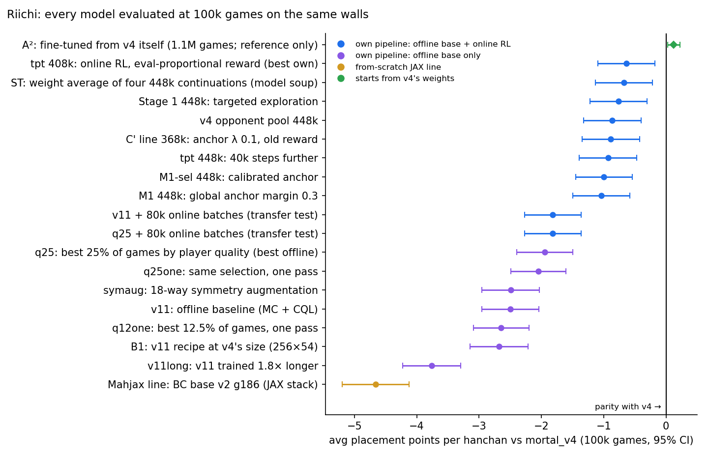
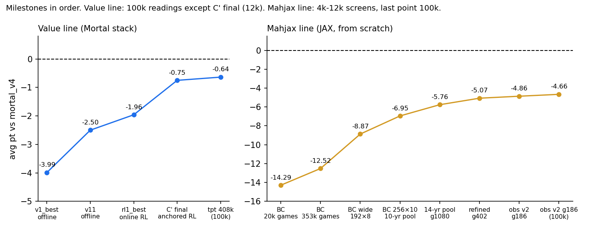
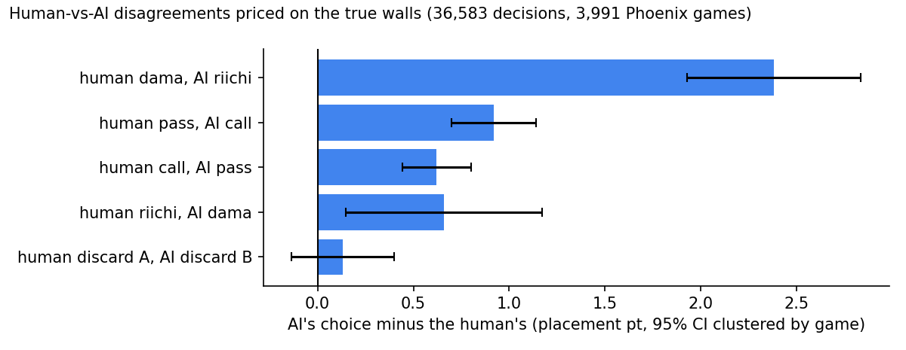
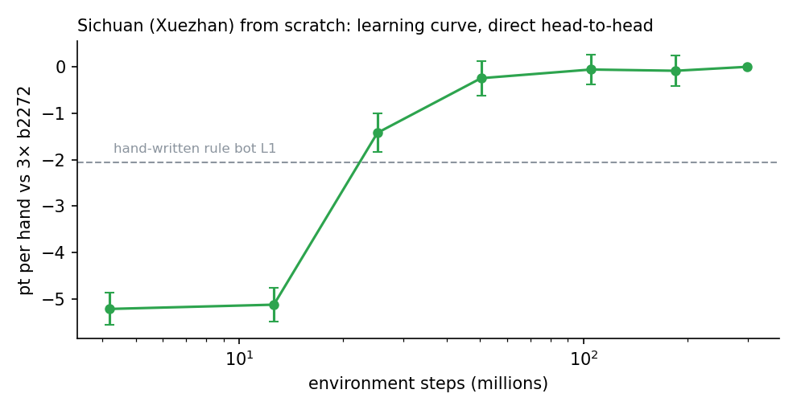
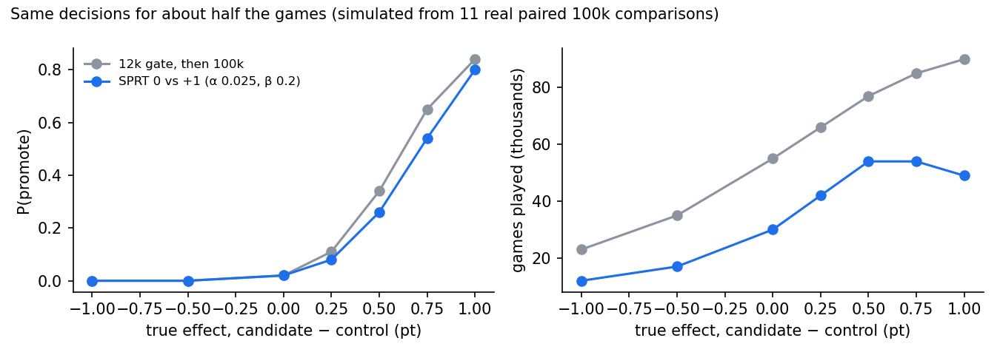

# TanyaoDojo

TanyaoDojo is a research workbench for training mahjong AIs with our own pipelines and measuring them strictly. The
main goal is in **Japanese riichi mahjong**: to beat **Mortal v4** (256ch × 54 blocks, 23.8M parameters, one of the
strongest open-source riichi AIs) with a model trained end to end by this project. That means an offline base learned
from human game logs, then our own online reinforcement learning. Fine-tuning v4's own weights is measured, but it does
not count toward the goal. Two sister lines share the tooling: a fully GPU-vectorized JAX stack, and from-scratch RL
for **Sichuan mahjong**.

> **License.** MIT at the root; `jax_rl/mjai_bot/` and the Mortal patches are AGPL-3.0 (they link libriichi or modify
> upstream [Mortal](https://github.com/Equim-chan/Mortal)). See [LICENSING.md](LICENSING.md).
>
> **Data.** Tenhou game logs and anything derived from them are not distributed. [SETUP.md](SETUP.md) shows how to
> rebuild from your own logs.
>
> **Weights.** Four checkpoints are published at [🤗 Twu31/TanyaoDojo](https://huggingface.co/Twu31/TanyaoDojo).
>
> **Evaluation module.** Counterfactual rollouts on the true walls, decision-level EV maps and luck control variates
> live in a separate repository, [riichi-eval](https://github.com/twu3202/riichi-eval).
>
> **Play a full game.** [🀄 TanyaoDojo Mahjong](https://huggingface.co/spaces/Twu31/TanyaoDojo-Play) supports riichi hanchan,
> Sichuan Xuezhan, two Hongzhong bonus profiles, Fangchenggang Hongzhong, Wenzhou Fangpao, Changsha Zhuanzhuan,
> Taishun, Xuanhua, Shaanxi, Lishui Fangpao, Wenxi, Guilin Zhuanzhuan, Pook Dazhong, Shanxi Datang Tuidaohu,
> no-flower Hong Kong Old Style, Macau Tournament Mahjong, Shangsi, Hundred-Tile Mahjong, Hezhou,
> Liuzhou Exploding Fish, Guangzhou Three-Faan, Golden Island Guangdong and Guiliu Wake-Tile Mahjong
> against three AI opponents. The UI defaults to English,
> with a persistent Simplified Chinese option; beginner heuristics and existing trained models are available.
> Source and deployment notes: [`deploy/play/`](deploy/play/README.md).
>
> **Analyze a position.** [🀄 What would the model discard?](https://huggingface.co/spaces/Twu31/TanyaoDojo-decisions) is an
> interactive Space with the best own model (tpt 408k). It also serves `POST /v1/decisions`, a decision-model
> interface for any position given as an mjai log ([`decision_api.py`](jax_rl/mjai_bot/decision_api.py)).

## Where it stands (2026-11-11)

All numbers are average placement points per hanchan against mortal_v4, at 100k games with a 95% CI, unless marked.

| | Result |
| --- | --- |
| **Goal: own pipeline ≥ v4** (point estimate ≥ +0.01 at 100k; CI > 0 to claim "beats") | **not reached yet** |
| Best own model (offline base v11 + online RL, tpt 408k) | **−0.64 ± 0.46** |
| Best offline base (q25: the 25% of games with the best-scoring players) | −1.95 ± 0.45, i.e. +0.55 ± 0.60 over the v11 base |
| Fine-tuned from v4's own weights (A², reference only) | **+0.123 ± 0.101** over 1.1M games: the online recipe can lift a v4-strength model |
| Mahjax line (JAX stack, behaviour-cloning base) | −4.66 ± 0.54 (line stopped) |
| Sichuan, from scratch | beats the hand-written rule bot L1 by **+2.92 ± 0.57** (z 10.1) at 105M steps |

## The three lines

| Line | Approach | Status |
| --- | --- | --- |
| **Value line** (main) | Mortal-architecture Q network, 192 × 40. Offline Monte-Carlo targets + CQL on 2.51M Tenhou Phoenix games (16 years), then online self-play value regression anchored to a frozen model | Active. Own best −0.64. A better offline base (+0.55) did not survive the first online stage; the online plateau at 408k is the open problem |
| **Mahjax line** | Everything rebuilt in JAX from scratch: environment, observations, BC, PPO / league RL | Stopped 2026-09-11 at −4.66. Most valuable output: the objective-mismatch finding (below) |
| **Sichuan line** | Pure RL from random initialization on a JAX Xuezhan environment, differential-tested against a reference implementation | P2 passed (beats L1); P3 paused after four interventions all measured zero |

## Evaluation protocol

Every riichi number in this repository uses the same protocol, which has never been changed. The Sichuan line uses
the same duplicate shape against its own rule-bot ladder.

- **Format.** Duplicate 1v3: the challenger takes each of the four seats on the same wall, and the other three seats
  are mortal_v4.
- **Fixed settings.** seed_key 20260711, seeds from 10000, pt [90, 45, 0, −135].
- **Unit.** The seed group (four rotations). At 100k games the 95% CI is ±0.46 against v4, and ±0.56 for a paired
  difference of two models on the same walls.
- **Diagnostics.** Every evaluation also reports mechanism readouts: gap by phase, placement distribution, bust rate,
  deal-in / riichi / call rates.
- **Acceptance.** `group_ci.py --strict` refuses a run with a missing rotation or an unfinished game.
- **Records.** A record needs the two-segment 12k at least; milestones use 100k.
- **Screening** (from 2026-10-21). Candidate-vs-control comparisons stop early by a sequential test on seed groups
  (SPRT 0 vs +1.0, α 0.025, β 0.2, looks every 4k games, cap 100k); a promote is confirmed on the fixed 100k
  ([sequential_eval](patches/sequential_eval/README.md)).

## Figures

**Every riichi model with a full 100k on the same walls.**
Online RL took the v11 base from −2.50 to −0.64. Every later online variant landed within noise of that. Among offline
bases, only selecting games by player quality moved the needle; capacity, augmentation and longer training did not.
One online stage of 80k batches brings v11 and the selected base q25 to the same −1.82.

**Milestones of the two riichi lines.**

**Where Phoenix-room humans lose to the AI, priced on the true walls.**
Each human decision that mortal_v4 disagrees with is replayed from the real wall: the human's choice in one branch, the
AI's in the other, with v4 playing all four seats afterwards. Reshuffling the unseen tiles 8 times gives the variance.
The AI's choice is worth more in every decision type with a real effect. The largest gap is declaring riichi where a
human stays silent (dama).

**Sichuan from scratch, measured head-to-head against the strongest snapshot.**
Learning finished around 50M steps. Against out-of-lineage opponents, steps ×6, capacity ×3.8, a GAE fix and dual-clip
all measured zero after that.

**Evaluation economics.** A sequential test on seed groups makes the same promote / drop decisions as the current
"12k gate, then 100k" rule for about half the games. Replaying 11 real comparisons, it played 436k games instead of
924k.

## Selected findings

- **The training objective must be the evaluation objective.** Four Mahjax RL runs failed because the reward was
  single-hand raw points, while the score is hanchan placement. A single-hand maximizer has no concept of fourth place.
  ([HISTORY.md](HISTORY.md))
- **Rulers saturate silently, and self-lineage flatters.** A ruler against random opponents inverted the ordering
  above +6. A curve measured against our own snapshots overstated external progress 2.3×. Claims now need an
  out-of-lineage opponent and a positive control. ([HISTORY.md](HISTORY.md#sichuan-line-xuezhan-bloody-to-the-end-progress))
- **Online gain came in stages, then stopped at 408k.** At 100k, the first online stage is worth about +0.6 over v11:
  rl1_best in July, and +0.68 ± 0.45 when replayed in the transfer test. The anchored stages after it added about
  +1.2 more, up to tpt 408k. Paired against 408k, every later variant was ≤ 0:
  - targeted exploration −0.13 ± 0.47;
  - calibrated anchors −0.36 and −0.40;
  - a v4-heavy opponent pool −0.23;
  - 40k more steps −0.30.

  ([RESULTS.md](RESULTS.md), [stage1_explore](patches/stage1_explore/README.md), [calibrated_anchor](patches/calibrated_anchor/README.md))
- **The offline base improves through data quality, not size.**

  | Change to the v11 base | Effect at 100k |
  | --- | --- |
  | v4-sized network (B1) | −0.18 ± 0.62 |
  | symmetry augmentation | +0.00 ± 0.60 |
  | 1.8× longer training | −1.26 ± 0.62 |
  | adding 1.34M Mahjong Soul games | −1.38 ± 1.77 at 12k |
  | training only on the 25% of games whose players score best (regret against v4) | +0.55 ± 0.60 |
  | the same at 12.5% of games | −0.15 ± 0.60 (data quantity binds) |

  ([data_quality](patches/data_quality/README.md), [majsoul_data](patches/majsoul_data/README.md),
  [symmetry_augmentation](patches/symmetry_augmentation/README.md))
- **That offline gain does not survive the first online stage.** v11 and q25 each trained 80k online batches with
  the same recipe and ended level: q25 online − v11 online = −0.00 ± 0.60. Online RL moved v11 by +0.68 and q25 by
  +0.13 (interaction −0.55, z −1.74). Both still trail 408k by 1.2, all of it in defence and in position before South
  4 ([online_transfer](patches/online_transfer/README.md)).
- **The remaining gap is in a few decision types.** Counterfactual EV maps against v4 put most of our lineage's
  deficit in push/fold (−0.15) and riichi judgement (−0.18). Ordinary tile choice costs about zero.
- **Measurement is the bottleneck.**
  - The paired per-group SD is 45 pt, so a 0.5-pt effect needs about 200–250k games to resolve. A 2-pt effect needs
    under 10k.
  - Making a large effect is cheaper than measuring a small one.
  - A sequential test halves the cost of the decisions we already make. It is the screening rule from 2026-10-21
    ([sequential_eval](patches/sequential_eval/README.md)).

## Recent experiments (newest first)

All listed riichi screening runs ended without a promotion. Riichi training remains paused.
On 2026-11-15, the user authorized a separate corrected-rule Sichuan baseline on the RTX 5060 Ti
(two 50.33M-step seeds with fixed follow-up evaluations; see [the run design](patches/sichuan_rulefix/README.md)).
A screening drop does not prove zero effect; dated claims that a whole direction is closed require this qualification.

- **Pessimism dose** (closed, 11-11: dropped by SPRT at 5,000 groups). v11 was fine-tuned offline with a smaller
  conservative weight, plain CQL. A base went online only if its large Q gaps shrank (p90 ≤ 0.7×) without lifting
  the greedy action. It then ran the first online stage as A80k did, screened by SPRT against A80k
  ([pessimism_dose](patches/pessimism_dose/README.md)).
  - Offline: weight 1 missed the gate (p90 0.88×). Weight 0.2 passed by a hair (p90 0.695×, median 0.29×).
  - Weight 0 lost the action order offline: median gap 0.03, agreement with the human 66% (v11 81%), test games
    −16.8. This is the Cal-QL collapse mechanism without any online stage.
  - Online, weight 0.2: A2_80k − A80k −0.58 ± 1.21 on 6,000 groups (LLR −1.88 at 5,000); vs v4 −2.42; − 408k −1.54.
  - Exploratory 12k: the base was no weaker than v11 (+0.73 ± 1.75). The first stage gained less from it than from
    v11, by 1.75 ± 1.99 (z −1.7).
  - Mechanism (suggestive): the lower pessimism survived the stage, but the fine-tune made riichi passive (−0.77 pp
    against v4, v11 +0.65). Both stages taught defence; only the control's also taught attack.
  - With Cal-QL, the offline conservative weight is set aside as a lever in both directions.
- **Calibrated offline base, Cal-QL** (closed, 11-10: the online arm collapsed within 8,000 batches)
  ([calibrated_base](patches/calibrated_base/README.md)).
  - Offline, Cal-QL halved the large Q gaps (p90 0.45×, call-available 0.43×). Online, the collapse guard stopped the
    arm at −12.9 and −17.7 against v4 (A80k's run: +0.5, −0.6).
  - On 1,000 groups: CQ8k vs v4 −13.05 ± 2.56, A80k's own run at 8k −3.43. Q gaps fell to 0.14, and 44% of the
    greedy choices differed from v11's.
  - Why: Cal-QL lifted the data action 1.8 above the level its returns support. Online Monte Carlo training removed
    the lift, and the greedy action landed on the second-best. The order of actions in our offline Q is held by the
    conservative term; plain CQL's pessimism is what lets the first online stage keep the policy.
- **Model soups** (closed, 11-10: neither soup beats the recipe). Uniform weight averages of training draws that
  share a start ([model_soup](patches/model_soup/README.md)).
  - SV, the five 160k arms from A80k: − pooled control −0.21 ± 0.40 (16,000 groups), − A80k +0.11; vs v4 −1.94.
  - ST, the four 448k continuations of tpt 408k: − 408k −0.04 ± 0.45 (100k), − mean of its ingredients +0.26 ± 0.34;
    vs v4 −0.68.
  - Averaging cancels the continuations' drift on the 408k line and lands back on 408k, but finds nothing above it. On
    the v11 line it keeps only a third of the stage's gain.
- **Four-seat self-play, S2** (closed, 11-10: dropped by SPRT at 3,000 groups). The control's stage from A80k with
  three workers in four-seat self-play (all seats trained, one rotation per seed) and one 1v3 against v4
  ([four_seat](patches/four_seat/README.md)).
  - FS160k − pooled control −0.47 ± 0.88 on 5,000 groups (SPRT segments −0.05 ± 1.13); − A80k −0.21; vs v4 −1.93.
  - It plays like the control: deal-in +0.14 pp, riichi −0.18 pp, attack −16 / defence −10 per kyoku. Training on
    every seat of one deal, and the current policy as opponent, changed neither strength nor profile.
- **Critic upper-bound diagnostic** (closed, 11-09: no critic reaches 0.20, the PG direction closes). Critics were
  fitted offline to the PG probe's own games and scored on 2,236 held-out games: the probe's head, a separate public
  critic, and privileged critics that also see the opponents' hands, or the wall too
  ([critic_diag](patches/critic_diag/README.md)).
  - The best critic explains 0.114 of the return's variance [0.105, 0.123], against 0.098 for the probe's own head
    (+0.016 [+0.012, +0.019]). It would cut the policy gradient's noise variance by 2%.
  - Seeing the wall adds nothing beyond seeing the hands (+0.000). Full-trunk critics overfit the 55,000 training games
    and never beat their start.
  - The first run gave no verdict: my trunk LR was about 80 times the probe's per sample. The second run fixed it and
    added two side critics that cannot damage the public features.
- **C′ step replay** (closed, 11-09: three replays, none reproduced). The step that made C′ final was retrained from
  C392k's July state with July's recipe: λ 0.5 to 240,000, then λ 0.2 to 278,600, anchored to rl1_best.
  - Against C392k, on 16,000 groups each, July's step read +1.08 ± 0.56. The three replays read:
    - +0.07 ± 0.54 on the 5060 Ti;
    - −0.12 ± 0.55 in a second draw there;
    - −0.15 ± 0.53 on trx with July's topology and card.
  - The topology contrast is −0.12 ± 0.48, so July's workers, freshness, pool and card add nothing measurable.
  - No replay's policy moved: riichi stayed at +2.07 to +2.95 pp, where July's fell to +0.58.
  - Reading set in advance: the July step was most likely a draw, and the C′ line closes
    ([cprime_replay](patches/cprime_replay/README.md)).
- **Unanchored first stage, P2** (phase 1 closed, 11-07). From v11 with July's recipe (no anchor, LR 5e-6), the fixed
  64k snapshot missed the pre-set gate: attack +0 per kyoku, riichi +0.88 pp. An evaluation-only trajectory then
  found the aggressive profile does grow:
  - it forms by 32k, peaks near 48k (attack +41, riichi +1.79 on 12k) and fades by 64k, at flat strength;
  - U40k, the snapshot July's best.pth rule picks, meets both thresholds on 16,000 groups (+20, +1.40)
  ([unanchored_first_stage](patches/unanchored_first_stage/README.md)).
- **C′ re-check** (closed, 11-06). The historical C′ jump, until now a 12k reading, holds on 13,000 new groups:
  C′ final − C392k = +0.98 ± 0.63 (z 3.1). C′ final is level with 408k. Its start rl1_best is as strong as the
  replay line's start but far more aggressive, and the relaxation repaired that. The replay line, anchored from its
  first batch, never had the aggression to repair ([cprime_recheck](patches/cprime_recheck/README.md)).
- **Control rerun** (closed, 11-06). Stage 2's control was trained a second time: +0.38 ± 0.53 over its start
  against the first run's +0.28, and the two runs differ by +0.10 ± 0.55 on 16,000 groups. The control's gain is
  the recipe, not its draw. Its "learned defence" was a 12k reading and is withdrawn
  ([online_control_rerun](patches/online_control_rerun/README.md)).
- **Separate policy and critic** (closed, 11-04). Stage 2 of the v11 line trained by PPO instead of Q regression
  was dropped at 2,000 groups: −1.61 ± 1.25 against the Q control on 4,000 groups, and −1.08 ± 1.24 against its own
  start. The policy moved as intended (2.4% of greedy decisions); it lost on both attack and defence. The critic
  explained under 10% of the return variance ([policy_critic](patches/policy_critic/README.md)).
- **Anchor schedule** (closed, 11-04). The historical C' schedule, 80k batches at λ 0.5 then 40k at λ 0.2, was
  dropped at 3,000 groups: −0.46 ± 0.99 against the control. The relaxation gave +0.20, against +1.56 in history.
  This was the last single recipe difference to the historical line
  ([online_anchor_schedule](patches/online_anchor_schedule/README.md)).
- **Reward schedule** (closed, 11-03). Stage 2 with the old training reward [6, 4, 2, 0] was dropped: −0.40 ± 0.91
  against the control. It gained attack and lost defence, where the control learned defence
  ([online_reward_schedule](patches/online_reward_schedule/README.md)). Before it, ten more re-anchored stages of
  the replay (240k → 1,040k) showed no trend, at about −1.91 against v4.
- **Snapshot ensemble** (closed, 10-29). The mean-Q ensemble of the four best own models at 100k was dropped at the
  first look: −1.67 ± 1.96 against 408k. It changed only 1.4% of decisions
  ([snapshot_ensemble](patches/snapshot_ensemble/README.md)).
- **Sample freshness** (closed, 10-29). The v11 line's stage 2 was repeated with each fresh sample trained on once
  instead of 1.8 times. It was dropped: −0.56 ± 0.89 against the reused control. The control learned defence in that
  stage and the fresh arm did not ([online_freshness](patches/online_freshness/README.md)).
- **Online capacity test** (closed, 10-27). With the same recipe, B1, the v4-sized base (256 × 54), is 2.3 behind v11
  at equal steps. The v11 line replayed on the 5060 Ti levels off about 1.1 below 408k
  ([online_capacity](patches/online_capacity/README.md)).
- **Early-end gap** (closed, 10-25). tpt 408k's last 0.64 points sit in games that end before South 4. No situation
  slice of the game-horizon EV map replicated on fresh walls. The one recurring family is pushing against riichi in
  the East, the known push defect ([early_end_gap](patches/early_end_gap/README.md)).
- **Evaluation throughput** (done, 10-21). Four processes with per-process thread caps play 1.55× the games per hour
  of the old layout, with every game byte-identical ([eval_throughput](patches/eval_throughput/README.md)).

## Repository layout

| Path | Contents |
| --- | --- |
| `jax_rl/` | Mahjax line: environment adaptation, observations, networks, BC / PPO / league trainers, `data_bridge/` (mjai parsing and replay) |
| `jax_rl/mjai_bot/` | Evaluation bridge and analysis tools, used by every line: `run_eval.py`, `group_ci.py`, `diag_*.py`, `seqtest.py`, data-quality and rollout tools (AGPL-3.0) |
| `patches/` | One directory per value-line experiment: the patch to upstream Mortal, run and evaluation scripts, and a README with the pre-registration and the result |
| `configs/`, `scripts/` | Value-line training configs and operation scripts |
| `sichuan/`, `common/` | Sichuan line: rules reference implementation, JAX environment, rule-bot ladder, duplicate arena, PPO trainer, lookup tables |
| `deploy/` | A Mortal-format bot shell for riichi.dev |
| `artifacts/` | Small derived tables used by features |
| `figures/` | The figures above and the script that draws them |

**Documents.**

| Document | Contents |
| --- | --- |
| [HISTORY.md](HISTORY.md) | The chronological project log, July to September 2026 |
| [RESULTS.md](RESULTS.md) | Value-line results in detail, including the 100k tables |
| [SETUP.md](SETUP.md) | Environment, upstream clones, data rebuilding, smoke checks |
| [sichuan/RULES.md](sichuan/RULES.md) | Sichuan rules, frozen v0 |
| [LICENSING.md](LICENSING.md) | Per-directory licensing |
